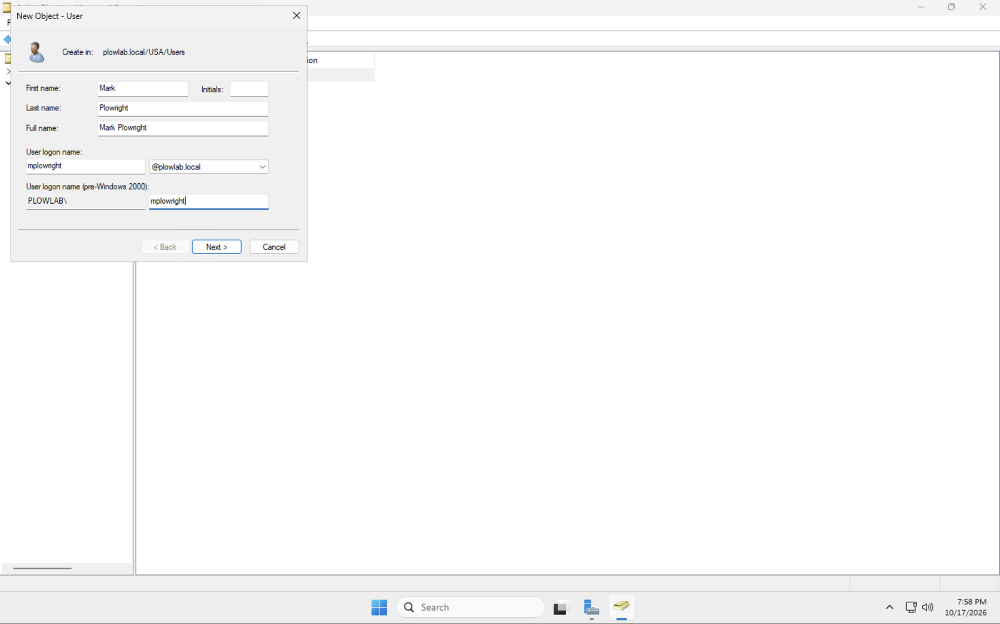
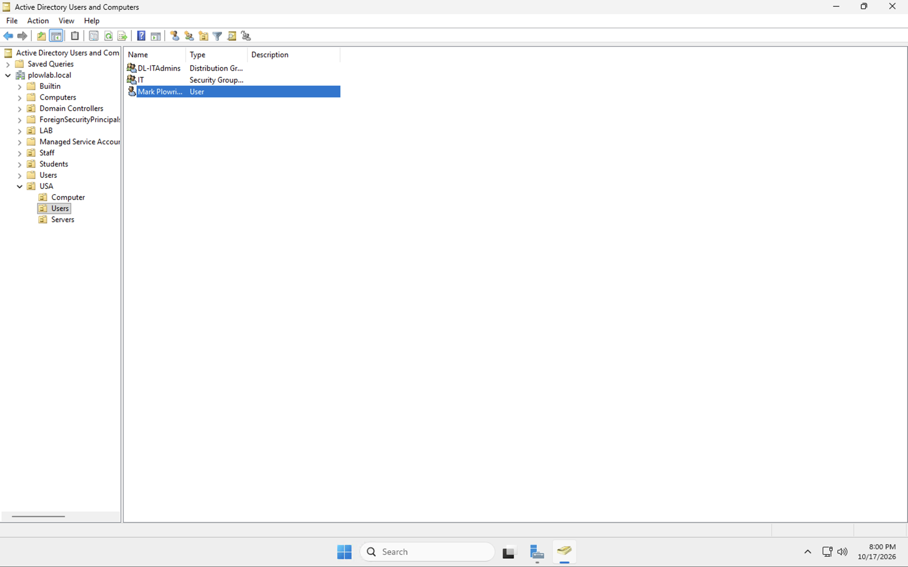

# 03 Create a domain user

## Goal

Create a user account in the domain, in an organizational unit (OU), so there is a real account for Group Policy to apply to.

## Steps

1. Open **Active Directory Users and Computers** (Server Manager > Tools).
2. Expand `plowlab.local`, then the `USA` OU, and select the `Users` OU. Right-click it and choose **New > User**.
3. Fill in the name and logon name:
   - First name: `Mark`, last name: `Plowright`
   - User logon name: `mplowright@plowlab.local`
   - Pre-Windows 2000 name: `PLOWLAB\mplowright`
4. Click **Next**, set an initial password, and keep **User must change password at next logon** ticked.
5. Click **Finish**. The account shows up in the OU list.

## Check that it worked

The new user appears in `plowlab.local/USA/Users` with the type **User**. The same OU already holds the `IT` security group and the `DL-ITAdmins` distribution group.

## What I learned

- The logon name has two forms: `mplowright@plowlab.local` (UPN) and `PLOWLAB\mplowright` (the older pre-Windows 2000 form). Both sign in to the same account.
- Where the user lives (which OU) decides which Group Policy Objects can reach them, so OU design matters before any policy work.
- Security groups control access to resources. Distribution groups are only for email lists.

## Next

[04 Group Policy objects](04-group-policy-objects.md)
