# 04 Group Policy objects (GPOs)

## Goal

Build six GPOs in Group Policy Management that cover common help desk and security tasks: password rules, account lockout, a mapped drive, a desktop wallpaper, a locked-down Control Panel, and blocked USB storage.

I followed a video walkthrough and wrote my own notes alongside it. This write-up records what I configured and what I could and could not confirm.

## Computer vs user configuration

The main idea behind where each setting lives:

- **Computer Configuration** follows the device and applies at startup, for anyone who signs in to it. Password, lockout and USB settings go here.
- **User Configuration** follows the person and applies at logon, on any computer in scope. Drive maps, wallpaper and Control Panel go here.
- **Policies** are enforced and users cannot change them. **Preferences** (drive maps, printers, shortcuts) set a starting point that users may change.

## How I created each GPO

1. Open **Group Policy Management** (Server Manager > Tools) and expand `Forest: plowlab.local > Domains > plowlab.local`.
2. Right-click `plowlab.local` and choose **Create a GPO in this domain, and Link it here**.
3. Name it, then right-click it and choose **Edit** to open the Group Policy Management Editor.

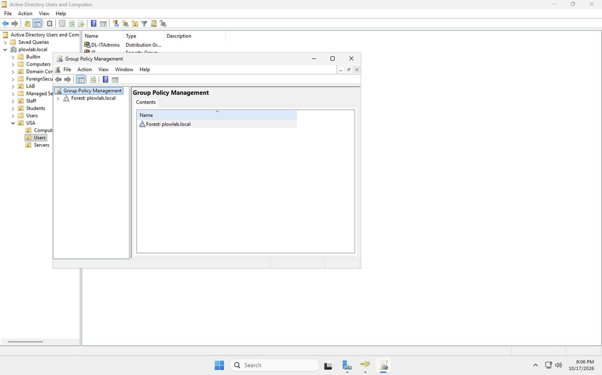

## The settings

| # | GPO | Config type | Path in the editor | Setting |
|---|---|---|---|---|
| 1 | Password Policy | Computer | Windows Settings > Security Settings > Account Policies > Password Policy | Minimum length 12, complexity enabled, maximum age 90 days |
| 2 | Drive Mapping | User | Preferences > Windows Settings > Drive Maps | New drive map, drive letter E |
| 3 | Desktop Wallpaper | User | Policies > Administrative Templates > Desktop > Desktop | Desktop Wallpaper enabled, style Fill |
| 4 | Restrict Control Panel | User | Policies > Administrative Templates > Control Panel | Prohibit access to Control Panel and PC settings: Enabled |
| 5 | Disable USB Devices | Computer | Policies > Administrative Templates > System > Removable Storage Access | All Removable Storage classes: Deny all access: Enabled |
| 6 (bonus) | Account Lockout Policy | Computer | Windows Settings > Security Settings > Account Policies > Account Lockout Policy | Threshold 5, duration 10 min, reset counter 10 min |

### 1. Password policy

Minimum length is 12 and complexity is on. When I set the 90-day maximum age, Windows offered to set a 30-day minimum age to match. That prompt is expected.

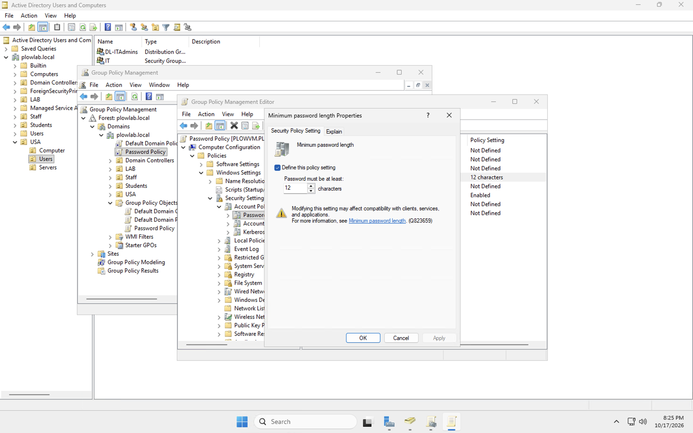

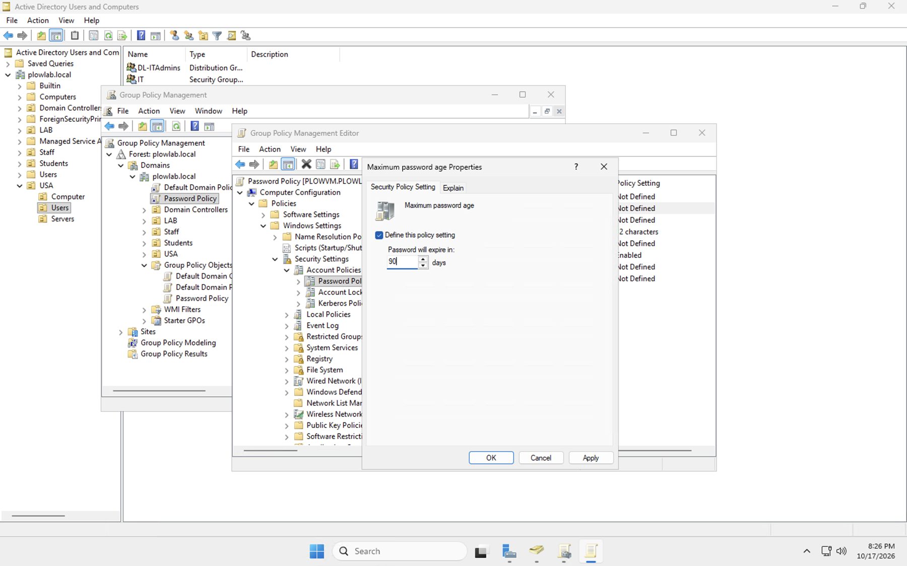

### 2. Drive mapping

A drive map item for `E:` with the action **Update**. The location is still the placeholder `\\servername\folder`, so it does not map a real share yet.

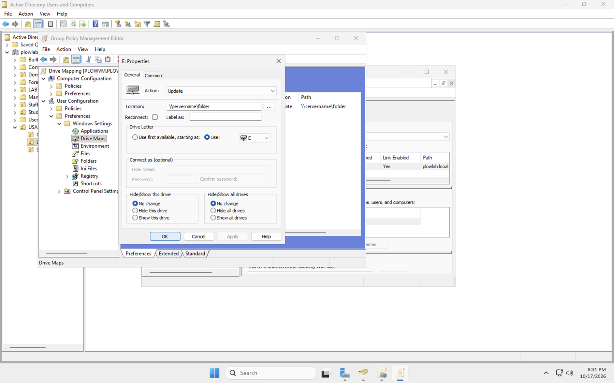

### 3. Desktop wallpaper

The setting is enabled with the style set to **Fill**. At this stage I had not set a working image path. It later turned out a local `C:\` path shows a black desktop on the client; the fix is in [runbook 08](08-wallpaper-gpo-fix.md). A working value looks like `\\SERVER\Share\wallpaper.jpg`.

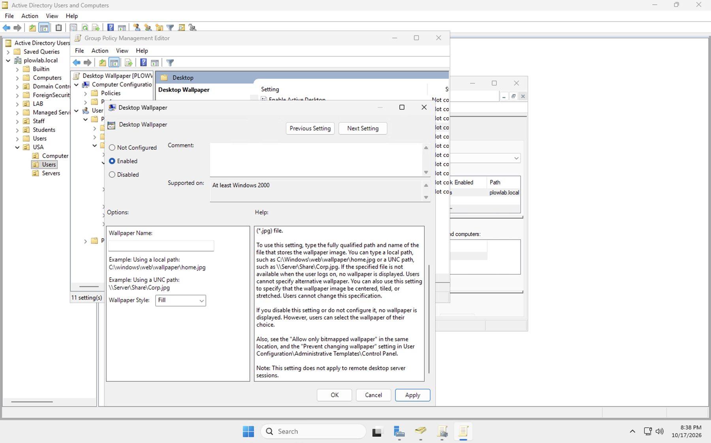

### 4. Restrict Control Panel

"Prohibit access to Control Panel and PC settings" shows **Enabled**.

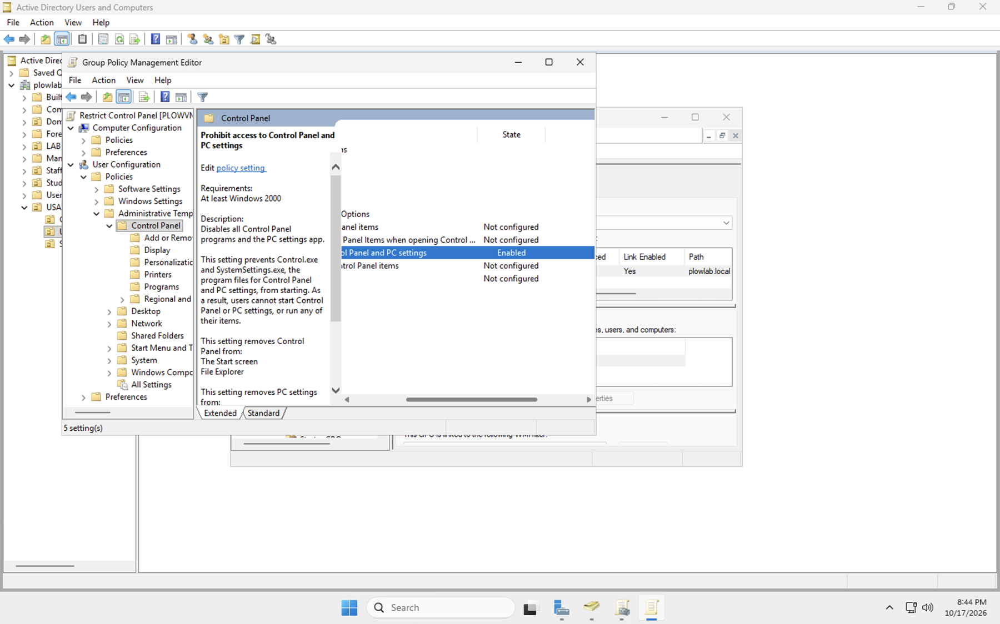

### 5. Disable USB storage

"All Removable Storage classes: Deny all access" is set to **Enabled**. It sits under Administrative Templates, not Windows Settings.

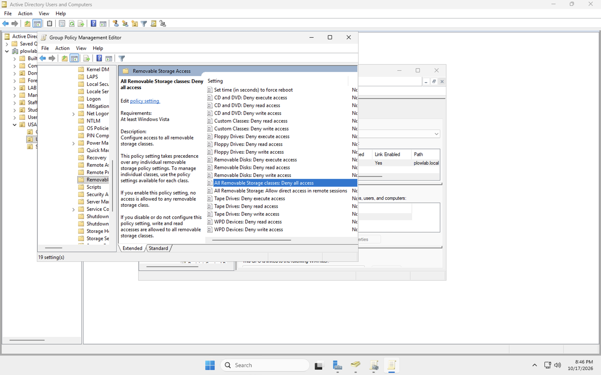

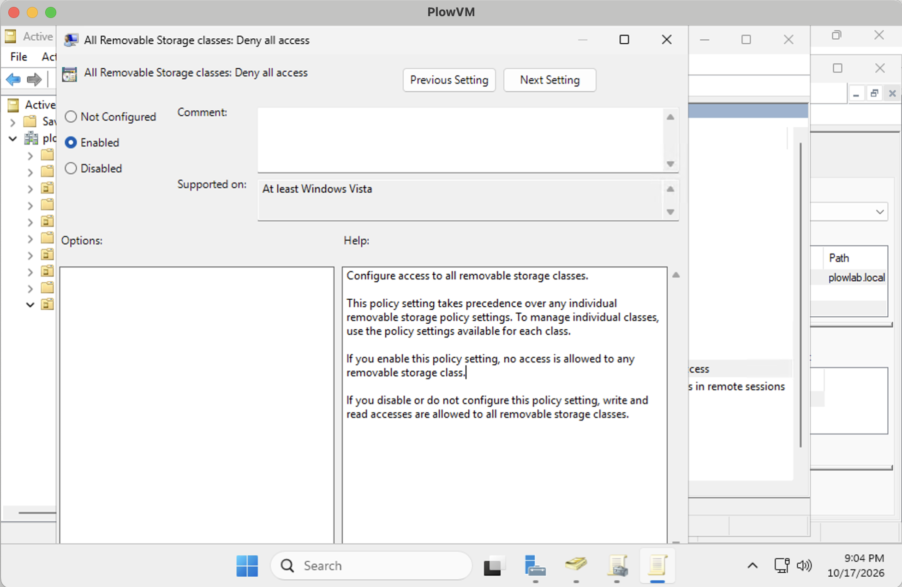

### 6. Account lockout (bonus)

An account locks after 5 invalid sign-ins and stays locked for 10 minutes. The counter resets after 10 minutes, and the Administrator account can be locked out too. Windows suggested the 10-minute duration and reset values when I set the threshold.

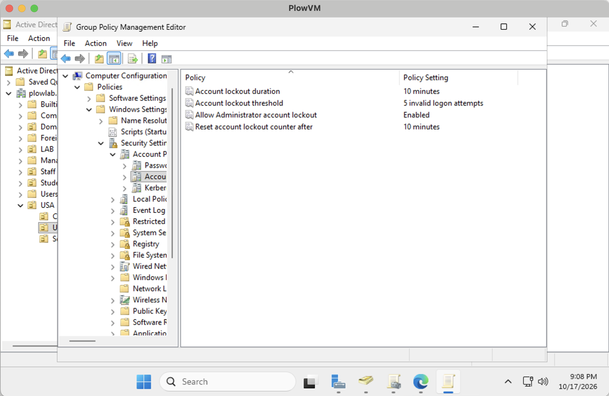

## Check that it worked

All six GPOs are linked to `plowlab.local` with **Link Enabled: Yes** and **Enforced: No**, and security filtering is set to **Authenticated Users**.

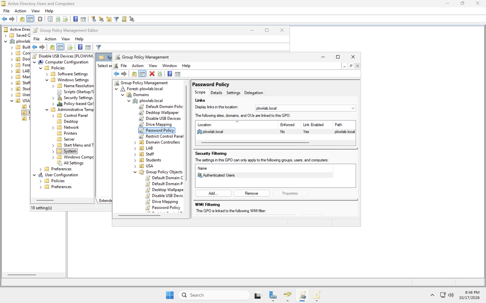

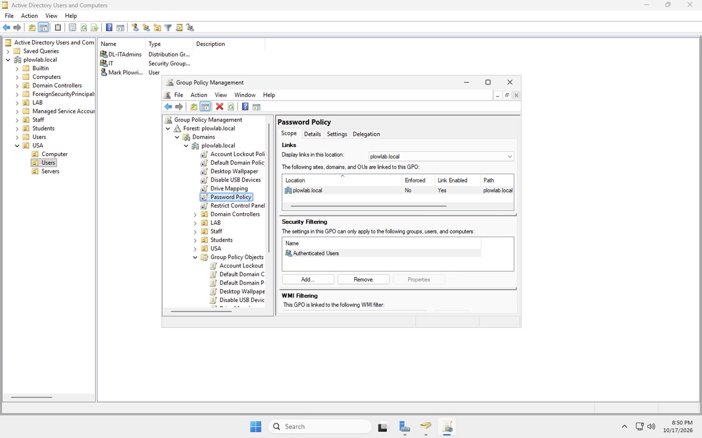

## What I learned

- **Link Enabled** switches a GPO on or off at one location. **Enforced** makes it win over conflicting GPOs. Neither one is about which users receive it. Location and security filtering decide that.
- Several GPOs linked at the same level are processed by link order. The lowest number wins when they conflict, so my password and lockout GPOs must sit above the Default Domain Policy to take effect.
- The Control Panel policy applies to any account in scope, including an admin account.
- Account lockout counts admin accounts too when "Allow Administrator account lockout" is enabled.

## Not done yet

- ~~Point the drive map at a real shared folder~~ Done with a new `Mapped Drives` GPO, see [runbook 06](06-file-share-and-mapped-drive.md). The older placeholder `Drive Mapping` GPO should be unlinked.
- ~~Add a wallpaper image on a share and set its path in the policy~~ Done, see [runbook 08](08-wallpaper-gpo-fix.md).
- Move the password and lockout GPOs above the Default Domain Policy and confirm with `Get-ADDefaultDomainPasswordPolicy`.
- ~~Join a client and verify with `gpresult`~~ Done, see [runbook 05](05-join-client-and-test-gpos.md).
- Finish re-linking the other user and computer GPOs (see **Where GPOs should be linked** below).
- Confirm the lockout settings sit in the **Account Lockout Policy** GPO. I edited part of them while the editor title read "Password Policy".

## Where GPOs should be linked

I first created every GPO linked at the domain root (`plowlab.local`), so they applied to everyone, including my admin account. My admin account `Plow` lives in the default `Users` container, which can only be reached by domain-level links, and the Restrict Control Panel GPO blocked Windows Settings on the domain controller.

| GPO type | Link it at |
|---|---|
| Password policy, account lockout (domain account policy) | Domain root. They only work there |
| Drive mapping, wallpaper, Control Panel restriction (user settings) | The OU that holds standard users, `USA > Users` |
| USB block (computer setting) | An OU that holds computer accounts, such as `USA > Computer`. The client must be moved out of the default `Computers` container |

How I fixed it: removed the domain-root link for Restrict Control Panel (deleting the link, not the GPO), linked it to `USA > Users`, then confirmed with `Get-GPInheritance`, `gpupdate /force` and `gpresult /r /scope user`. Settings then opened for my admin account, and the policy still applied to `mplowright`.

Lesson: right-click the target OU and choose **Create a GPO in this domain, and Link it here**, instead of doing it from the domain root. Keep admin accounts out of the OUs that restricted-user GPOs are linked to.

## Next

Join a Windows client to the domain and test these policies from the client.
