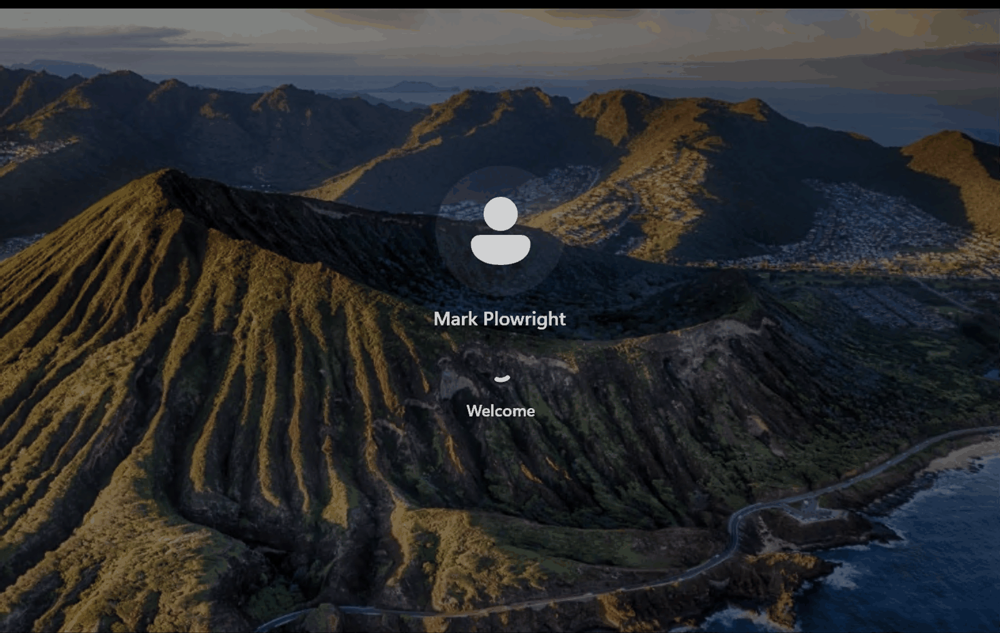
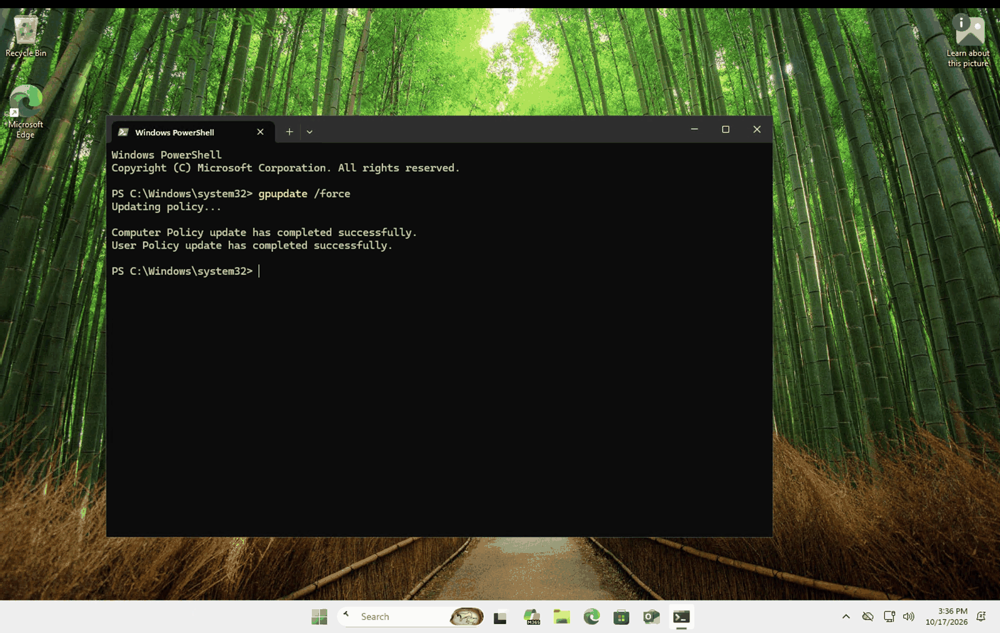
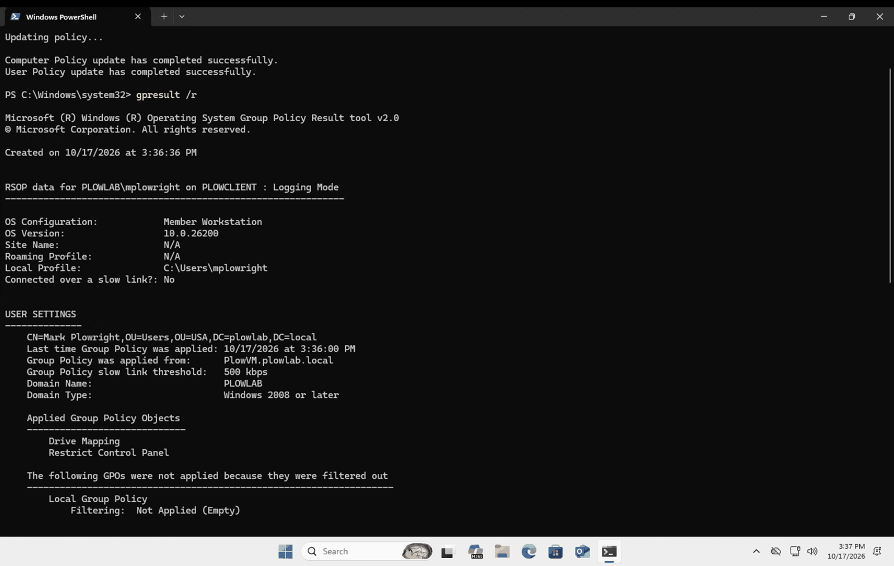
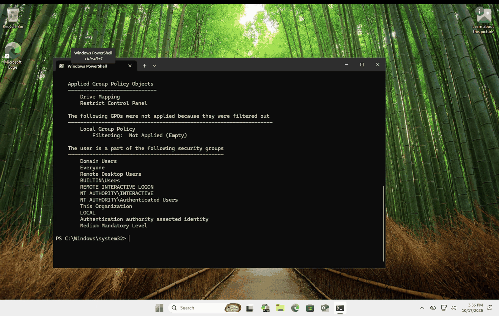
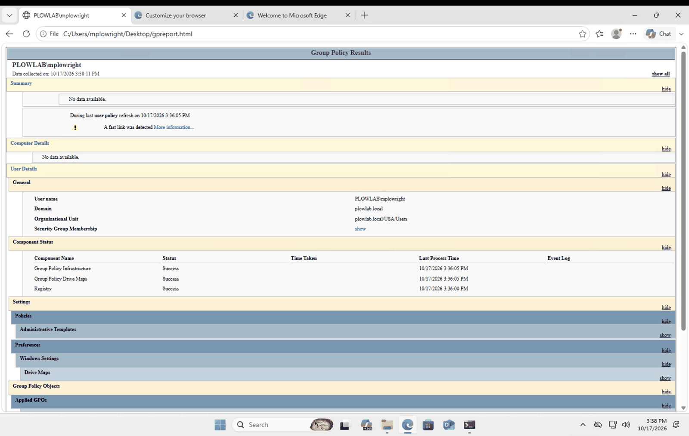
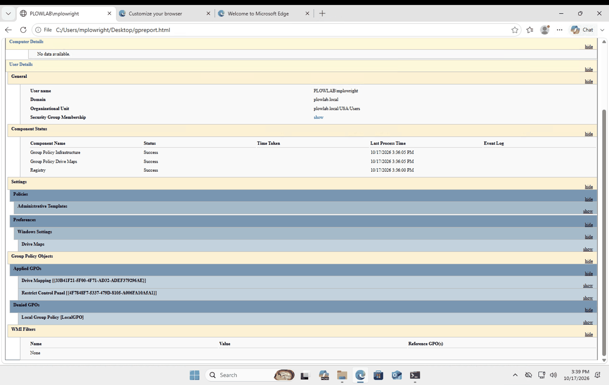
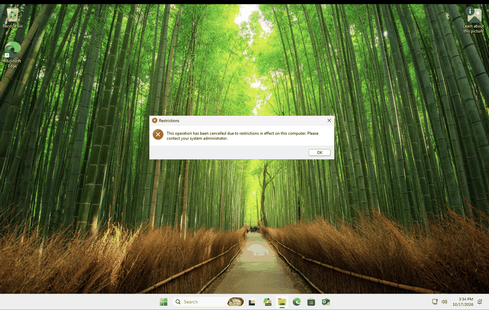

# 05. Join a client to the domain and test the GPOs

**Goal:** Prove the Group Policy objects from [runbook 04](04-group-policy-objects.md) actually reach a user on a real domain-joined Windows machine.

## What I built

- A second Azure VM, `PLOWCLIENT`, running Windows 11 Pro/Enterprise, in the **same virtual network and subnet** as the domain controller `PLOWVM`.
- Joined it to `plowlab.local`.
- Signed in as the domain user `PLOWLAB\mplowright` and verified policy with `gpupdate`, `gpresult` and a real restriction.

## Steps

1. Create the client VM in Azure. Use the existing virtual network and subnet (not a new one). Local admin account: `clientadmin`.
2. Point the client at the domain controller for DNS (see Problems below). Check with `ipconfig /all`: the DNS server must be the DC's private IP, not `168.63.129.16`.
3. Confirm name resolution: `nslookup plowlab.local` returns the DC.
4. Join the domain: `sysdm.cpl` > Change > Domain `plowlab.local`, sign in with a domain account, restart.
5. Allow the domain user to connect over RDP: `net localgroup "Remote Desktop Users" "PLOWLAB\mplowright" /add`.
6. Reconnect and sign in as `PLOWLAB\mplowright` (not `clientadmin`, which is a local account).



## Testing

### Force a policy refresh

```
gpupdate /force
```

Both Computer Policy and User Policy updated successfully.



### See which GPOs applied

```
gpresult /r
```

The report is for `PLOWLAB\mplowright` on `PLOWCLIENT`. The user is in `OU=Users,OU=USA,DC=plowlab,DC=local`, policy came from `PlowVM.plowlab.local`, and **Applied Group Policy Objects** lists **Drive Mapping** and **Restrict Control Panel**.




### HTML report

```
gpresult /h $env:USERPROFILE\Desktop\gpreport.html
```

The component status shows Group Policy Infrastructure, Drive Maps and Registry all **Success**, and both GPOs are listed under Applied GPOs.




### Real-world proof: Control Panel is blocked

Opening Control Panel as `mplowright` gives the message "This operation has been cancelled due to restrictions in effect on this computer. Please contact your system administrator."



## Troubleshooting DNS (the biggest problem)

The domain join depends on the client finding the domain controller through DNS. Mine could not, so I worked through it step by step.

1. **Symptom:** `nslookup plowlab.local` on the client failed to find the domain.
2. **Narrowed it down:** Pointing `nslookup` directly at the DC's private IP (`nslookup plowlab.local <DC private IP>`) returned the correct answers. So the domain's DNS records were fine and the DC was fine. The client was just asking the wrong DNS server.
3. **Found the cause:** The default server in the `nslookup` output was `168.63.129.16`, Azure's built-in DNS. `ipconfig /all` on the client confirmed the same. Azure's DNS does not know about my private domain.
4. **Checked the network card:** The client's NIC was set to "Inherit from virtual network", so the fix belongs on the virtual network, not on the VM.
5. **Fixed it:** Virtual network > DNS servers > **Custom**, entered the domain controller's private IP, and saved. Both VMs share this network, so the DC and the client now use the same DNS.
6. **Applied it:** Restarted the client so it picked up the new DNS setting.
7. **Verified:** `ipconfig /all` showed the DC's private IP as the DNS server, and `nslookup plowlab.local` resolved. Only then did I join the domain.

**Lesson:** In Azure, a domain-joined machine must use the domain controller for DNS. The DC also needs a static private IP so that setting never breaks. If DNS points anywhere else, the join fails even though everything else is correct.

## Results

| GPO | Result on the client |
|---|---|
| Restrict Control Panel | Applied and enforced. Control Panel is blocked for the user |
| Drive Mapping | Applied (Drive Maps component: Success). No drive appears because the path is still the placeholder `\\servername\folder` |
| Desktop wallpaper | Not in the applied list for this user. Needs a look (see Next steps) |
| Password policy, account lockout, USB block | Computer or domain-level settings. Not shown in a standard-user `gpresult`; need an elevated check |

## Problems I hit

| Problem | Cause | Fix |
|---|---|---|
| Client could not find `plowlab.local` | The client was using Azure's default DNS (`168.63.129.16`), which knows nothing about my domain | Set the virtual network's DNS servers to **Custom** with the DC's private IP, restarted the client, confirmed with `ipconfig /all` |
| Remote Desktop kept signing in as `clientadmin` | The Windows App had saved credentials | Edited the saved PC to **Ask when required** and typed `PLOWLAB\mplowright` |
| "You must change your password before signing in" | The new user had "User must change password at next logon" ticked, which blocks RDP sign-in | In Active Directory Users and Computers, reset the password and unticked that box |
| `gpresult /h C:\gpreport.html` gave "Access is denied" | A standard user cannot write to the root of `C:\` | Saved the report to the Desktop instead |

## What I learned

- A domain join needs working DNS first. If the client cannot resolve the domain, nothing else works.
- Domain accounts need permission to connect over RDP, separate from being able to join the domain.
- `gpresult /r` shows which GPOs applied. `gpresult /h` makes a report that is easier to read and screenshot. Computer-side results need an elevated prompt.
- A GPO can be applied correctly even when you see no visible effect, such as a drive map pointing at a placeholder path.

## Next steps

- Create a real shared folder on `PLOWVM` and point the drive map at it.
- Check why the wallpaper GPO is not in the applied list (link location, enabled setting and image path).
- Run `gpresult /scope computer /r` from an admin prompt to confirm the computer-side policies.
- Move the password and lockout GPOs above the Default Domain Policy in link order.
