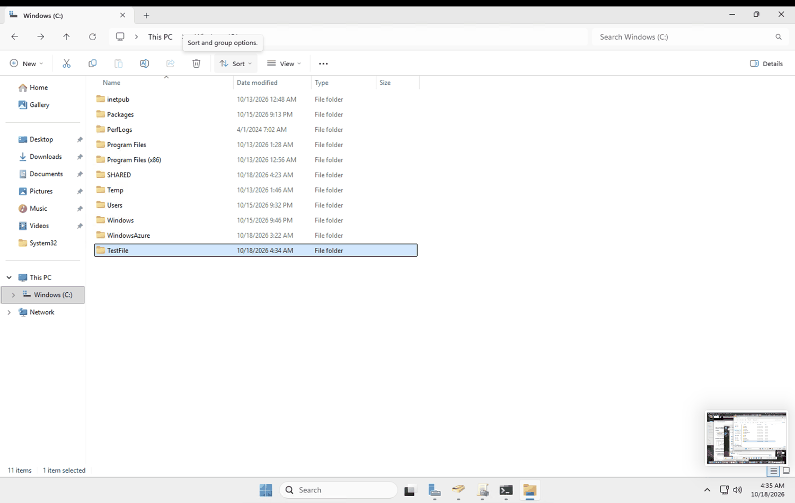
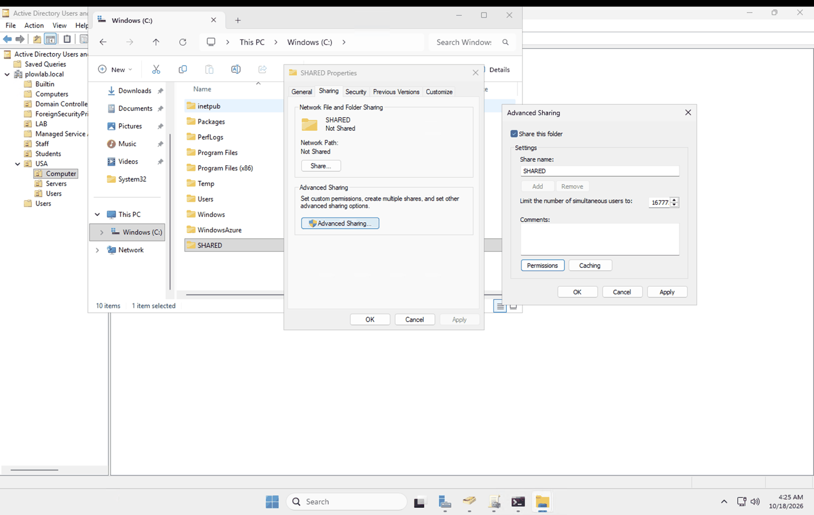
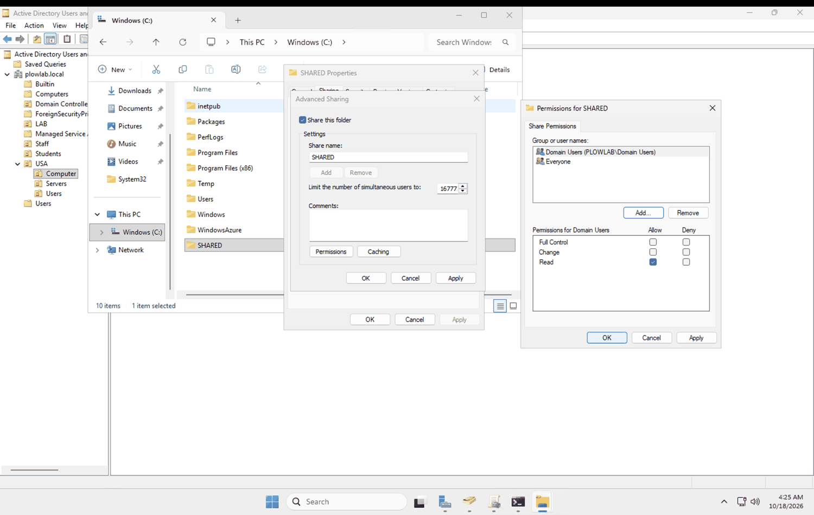
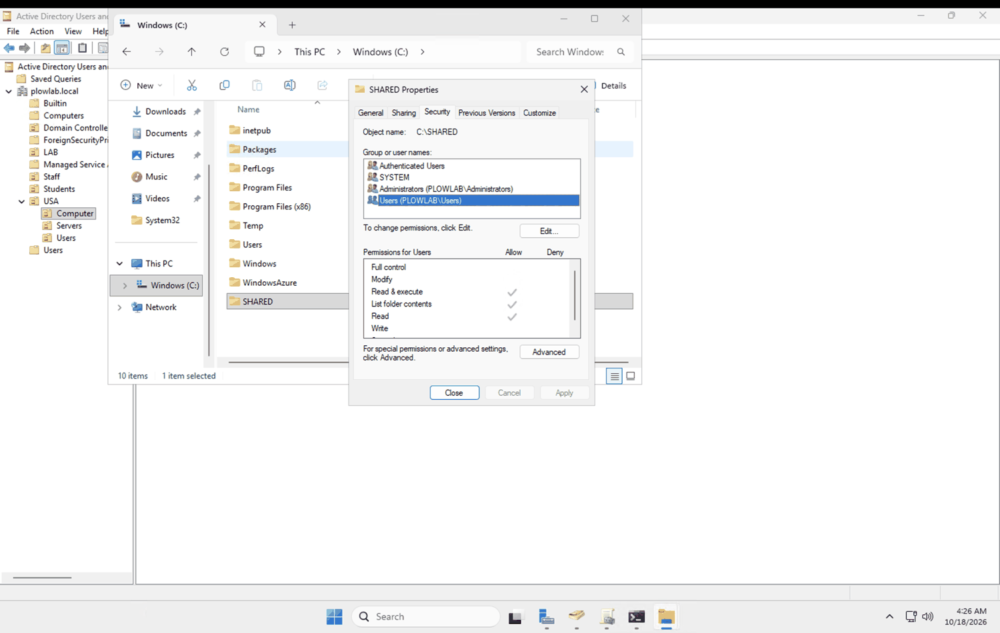
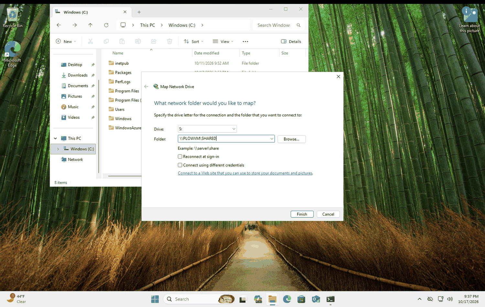
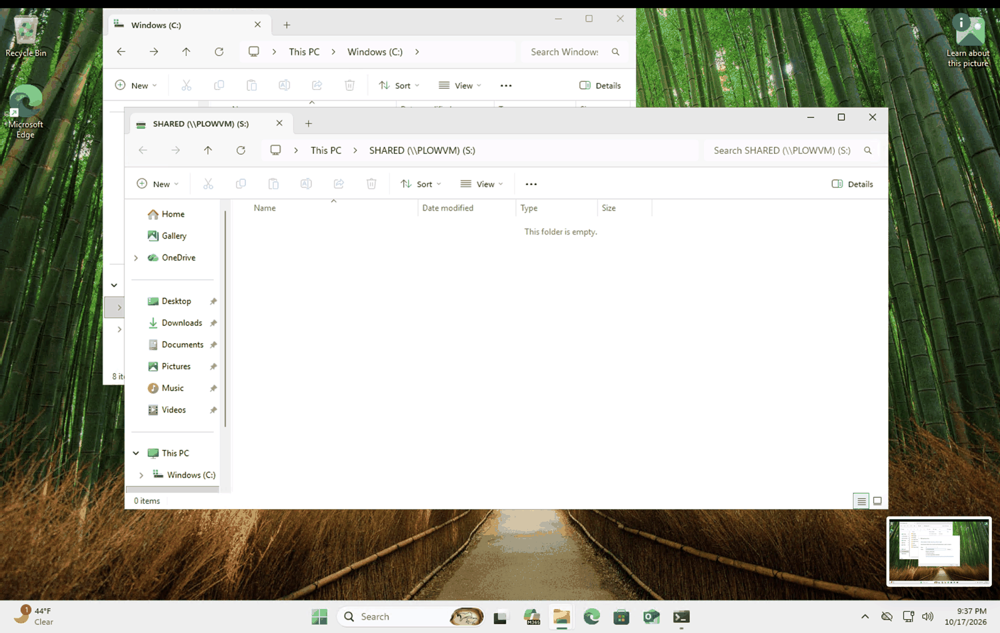
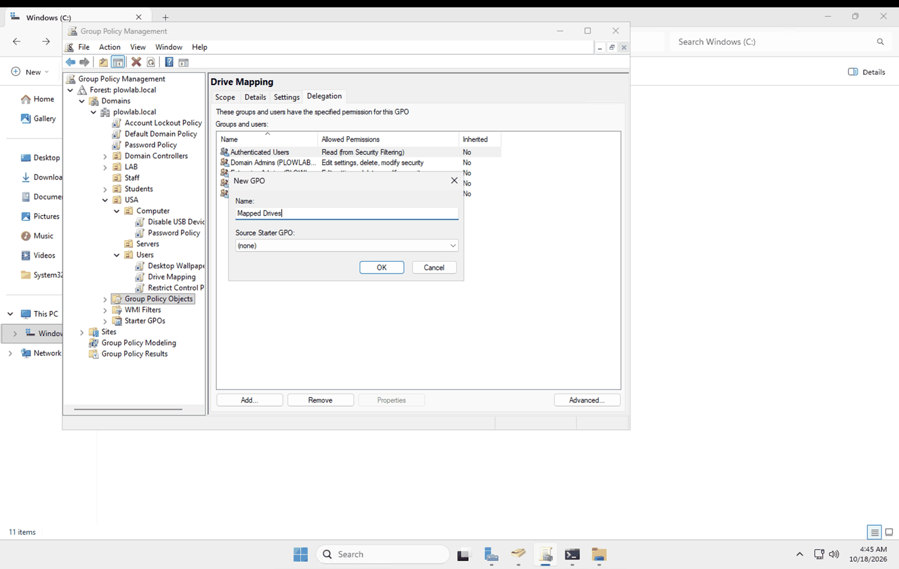
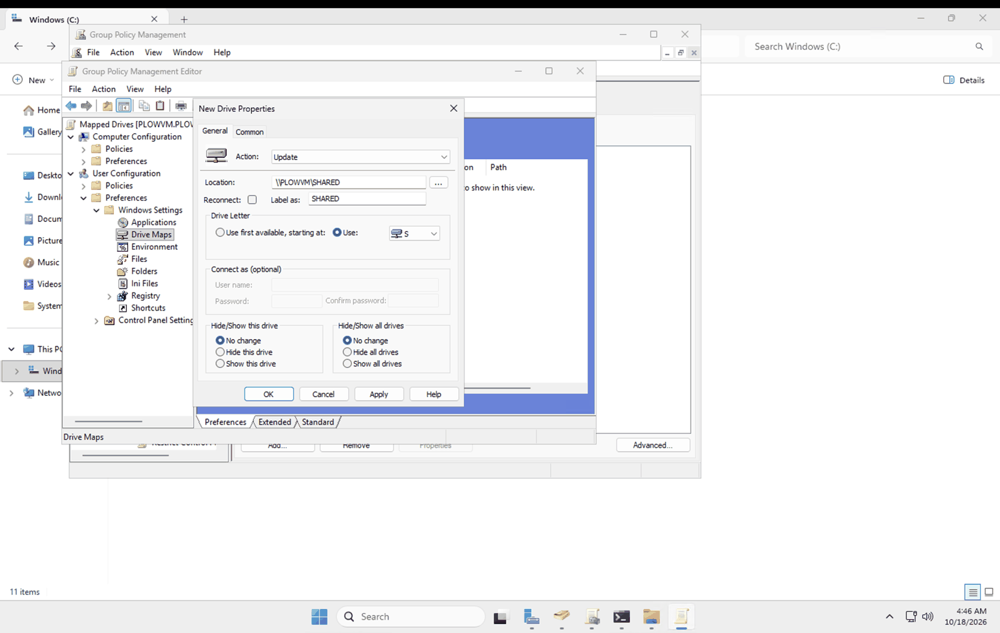
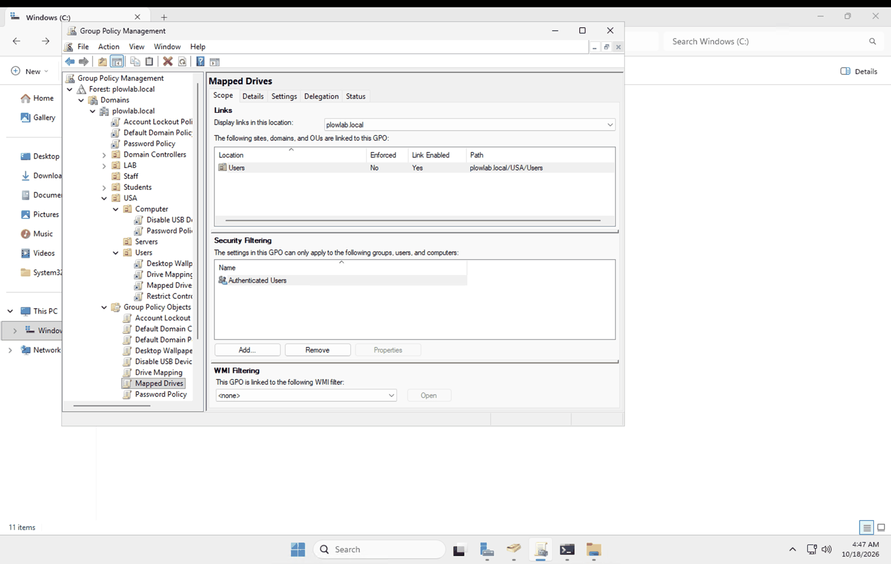

# 06. File share and a mapped drive (manual, then by GPO)

**Goal:** Share a folder from the server, make sure a domain user can reach it over the network, then automate the mapped drive with Group Policy.

## Background

- **UNC path:** `\\server\share` is how Windows addresses a shared resource over the network. The leading `\\` means "this is on another computer." The server name is resolved through DNS, so this only works if DNS is healthy (see [runbook 05](05-join-client-and-test-gpos.md)).
- **Share permissions vs. NTFS permissions:** Share permissions control access over the network. NTFS permissions control the files and folders themselves. When both apply, the more restrictive one wins.
- **NTFS** stands for New Technology File System. It is the Windows file system that supports permissions, inheritance and quotas.

## 1. Create the shared folder

On `PLOWVM` I created a folder named `SHARED` at the root of the C: drive (`C:\SHARED`).

## 2. Share it

Folder Properties > **Sharing** tab > **Advanced Sharing** > tick **Share this folder**. The share name is `SHARED`.

Under **Permissions** the share is open to **Domain Users** (Read) and **Everyone**.

The **Security** tab shows the NTFS permissions. They are inherited from `C:\`, so Users get Read & execute and List folder contents.

Check the share from PowerShell with `Get-SmbShare`. It lists each share's name and the local folder behind it. `SHARED` points to `C:\SHARED`.

## 3. Map it by hand from the client

On `PLOWCLIENT` as `mplowright`: File Explorer > Map network drive. Drive `S:`, folder `\\PLOWVM\SHARED`.

I first tried `\\PLOWVM\TestingFile` and `\\PLOWVM\TestFile`. Those are **folder names**, not share names. A folder is only reachable by name over the network once it has been shared, and the share name can differ from the folder name. The path that works is `\\PLOWVM\SHARED`.

A manual mapping only exists for that user on that computer. The **Reconnect at sign-in** box keeps it across sign-ins, but it still has to be repeated on every machine.

## 4. Automate it with Group Policy

I created a new GPO named **Mapped Drives** and linked it to `USA > Users`.

In the GPO: **User Configuration > Preferences > Windows Settings > Drive Maps**, new mapped drive:

- Action: **Update**
- Location: `\\PLOWVM\SHARED`
- Label as: `SHARED`
- Drive letter: `S`

The Scope tab confirms the link is to `plowlab.local/USA/Users`, with Authenticated Users in the security filter.

Because it is a Preferences setting under User Configuration, it applies at sign-in after `gpupdate /force`.

## Problems and notes

| Problem | Cause | Fix |
|---|---|---|
| Trying to map a folder name failed to make sense | I used the folder name instead of the share name | Used the share name `SHARED` |
| Share permissions only give Domain Users **Read** | I did not raise them above the default | Write access needs both the share and NTFS layers to allow it, so the permissions model gets reworked in the next runbook (share open to Authenticated Users, NTFS restricts) |
