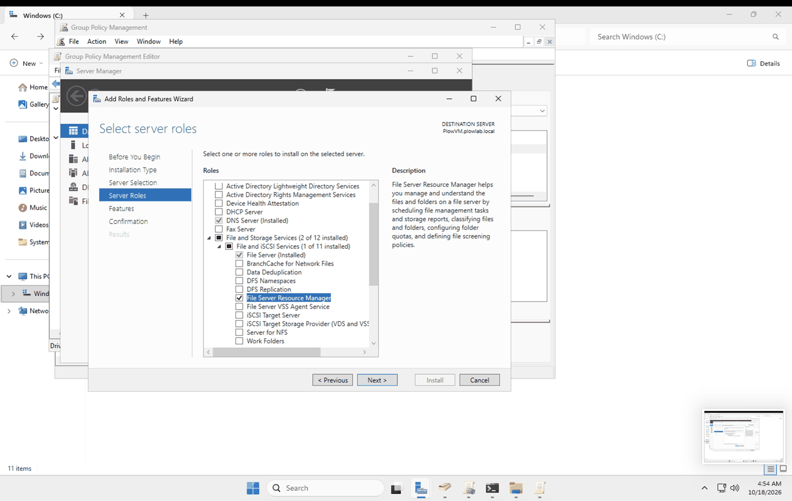
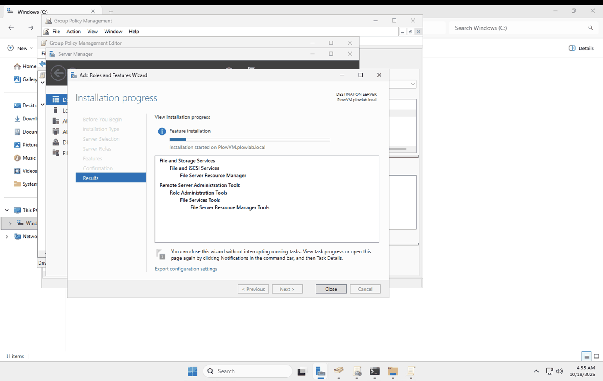
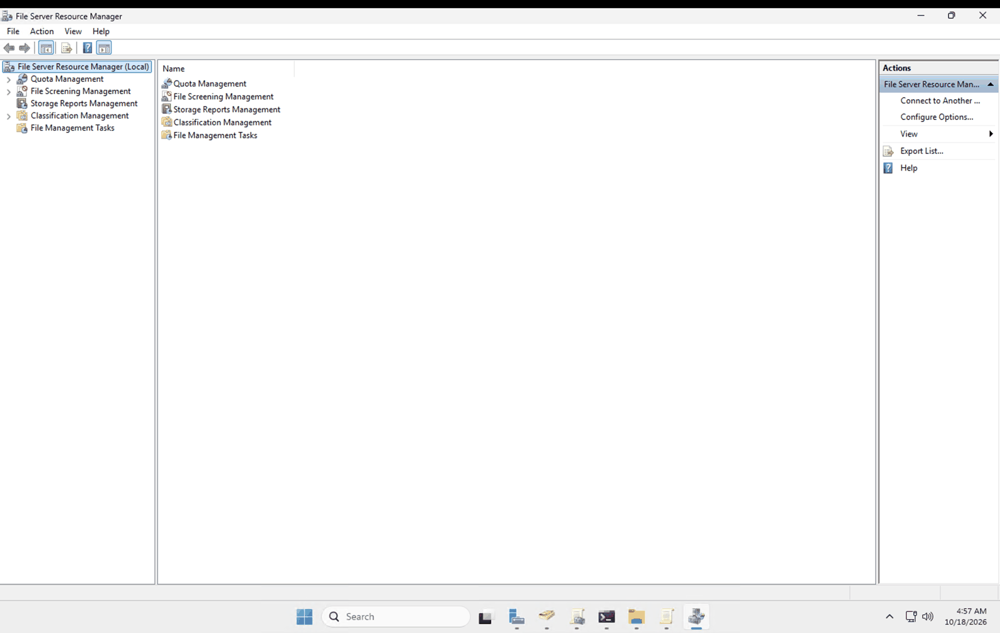
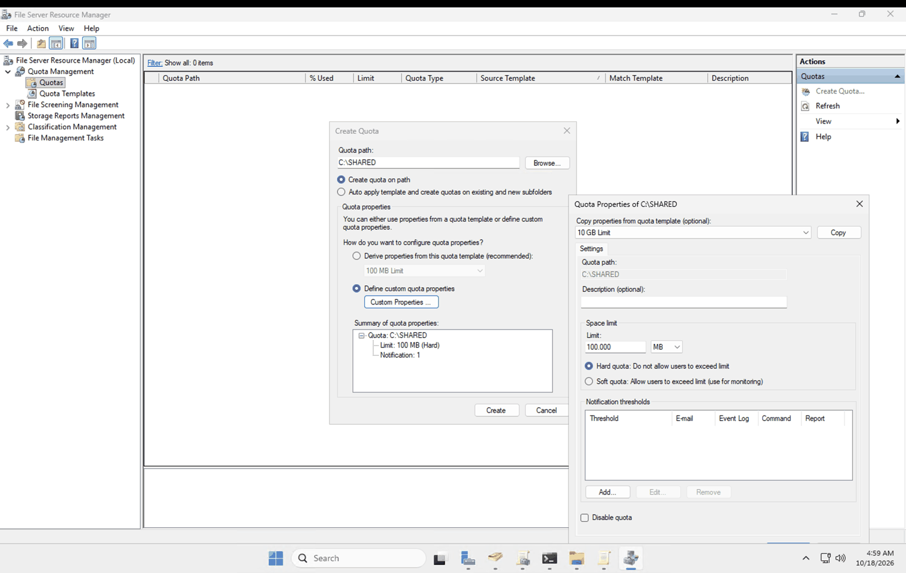
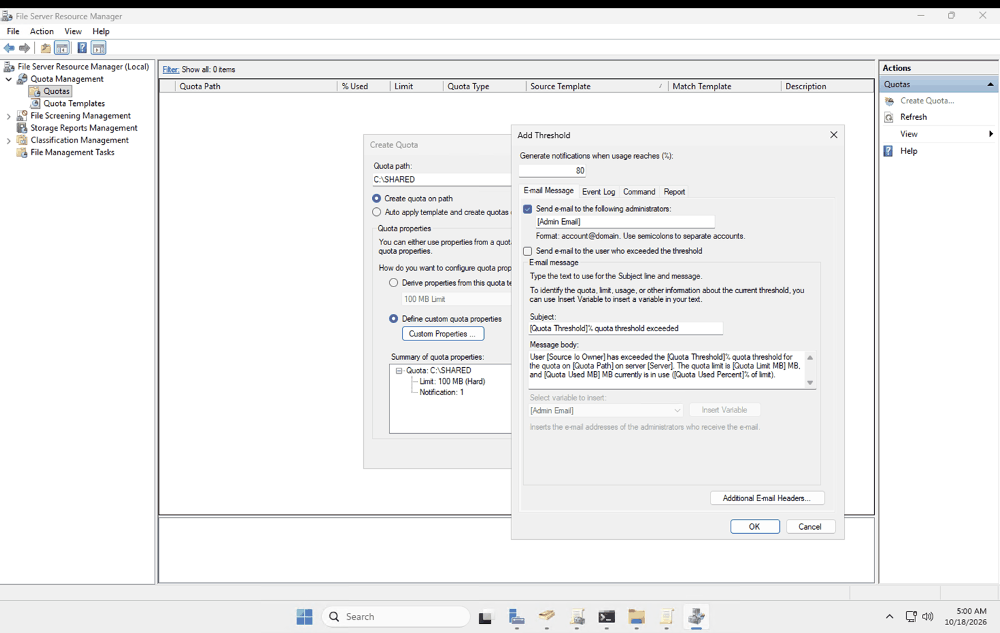
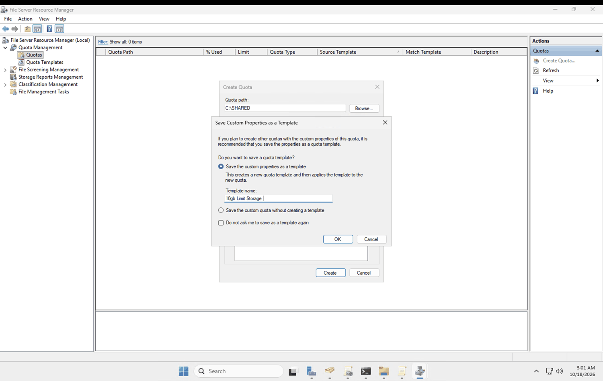
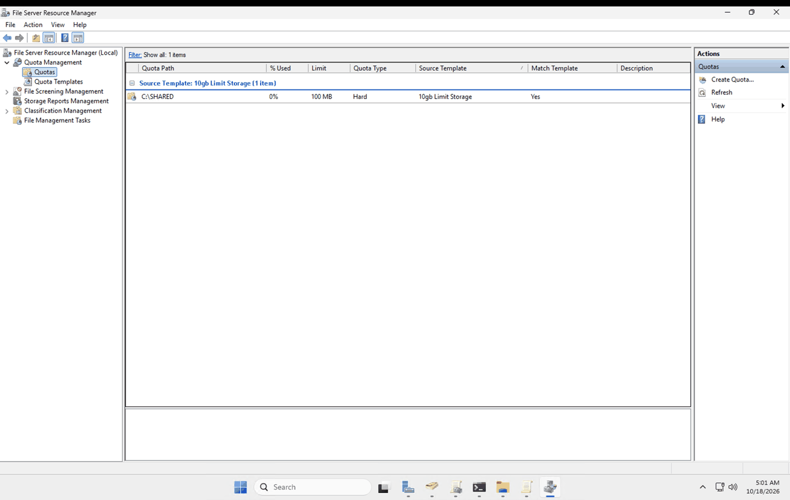
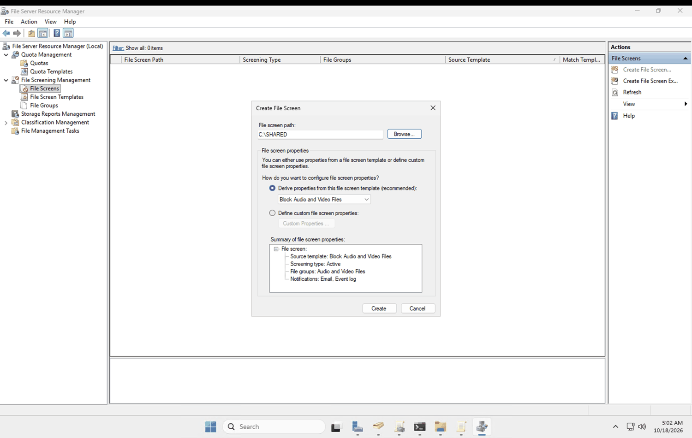
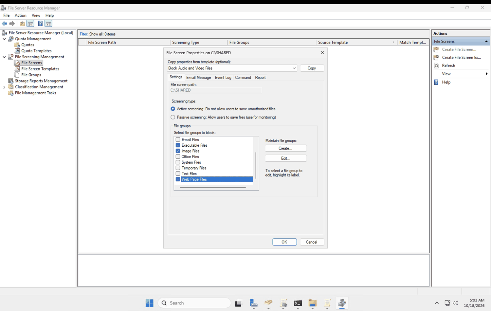
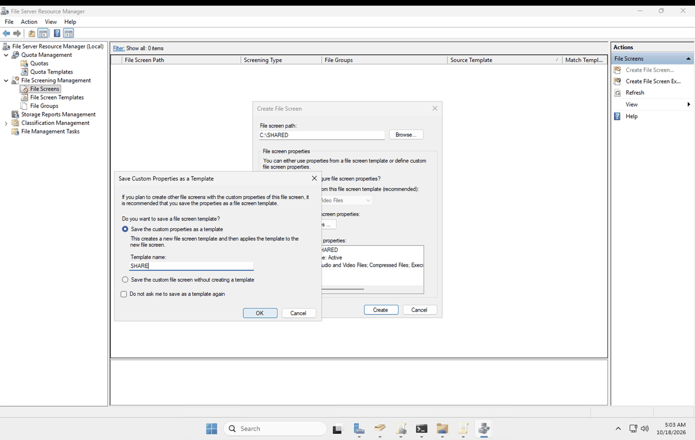

# 07. File Server Resource Manager: quotas and file screening

**Goal:** Use File Server Resource Manager (FSRM) to limit how much space the shared folder can use and to block unwanted file types.

## What FSRM does

- **Quotas:** Cap the space a folder can use. A **hard** quota refuses writes past the limit. A **soft** quota allows them and only reports.
- **File screens:** Block (**active**) or just log (**passive**) files by type, using **file groups** such as Audio and Video, Executable or Image.
- **Templates:** Reusable settings so the same quota or screen can be applied to many folders.

## 1. Install the role

Server Manager > Add Roles and Features > Server Roles > File and Storage Services > File and iSCSI Services > **File Server Resource Manager**. Accept the management tools it asks for.

Then open FSRM from the Tools menu. It lists Quota Management, File Screening Management, Storage Reports, Classification and File Management Tasks.

## 2. Quota

I created a quota on `C:\SHARED` with custom properties: **100 MB, hard**.

I added a notification threshold at 80% with an email option.

FSRM then asked whether to save the custom properties as a template, and I saved it as `10gb Limit Storage`.

The quota list shows `C:\SHARED`, 0% used, 100 MB, Hard.

**Note:** I built a custom quota first and the template came from saving it. The template name says 10 GB but the limit is 100 MB, so the name is wrong and should be renamed.

## 3. File screen

I created an **active** file screen on `C:\SHARED` with custom properties and chose the file groups to block, including Audio and Video, Compressed, Executable, Image and Web Page files.

Then I saved the custom properties as a template named `SHARE`.

## Things to know

- File screens are tricky. They apply to the whole folder tree and block by file type, so they can reject files you actually need. Mine blocks **Image files**, which means a wallpaper image cannot be stored in `SHARED`. The wallpaper will live in a different folder.
- **Email notifications will not send.** There is no SMTP mail server in this lab, so the email option would need one set up. The event log is the notification that works here.
- Active screening blocks the save. Passive screening only logs it, which is useful when you want to see what people store before blocking anything.

## Not tested yet

- Copying a blocked file type (such as an `.mp3`) from the client into the share, and confirming it is refused.
- Copying a file larger than 100 MB and confirming the quota stops it.
- Checking the event log for the resulting entries.
- Renaming the quota template and the `SHARE` file screen template to descriptive names.
