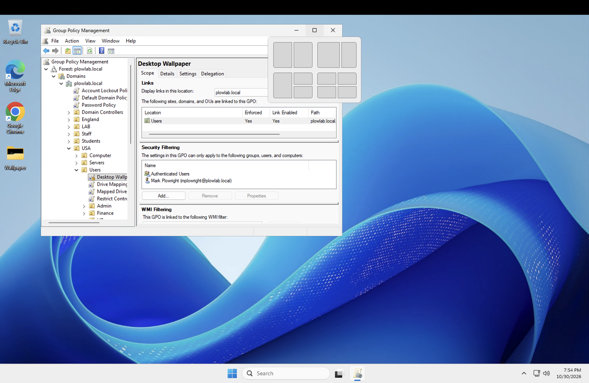
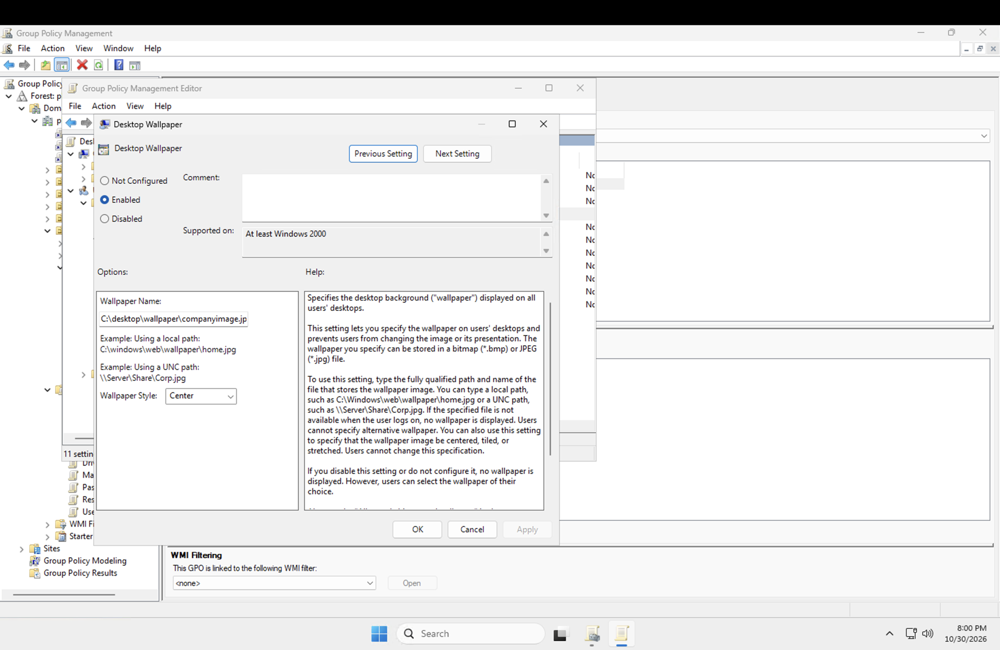
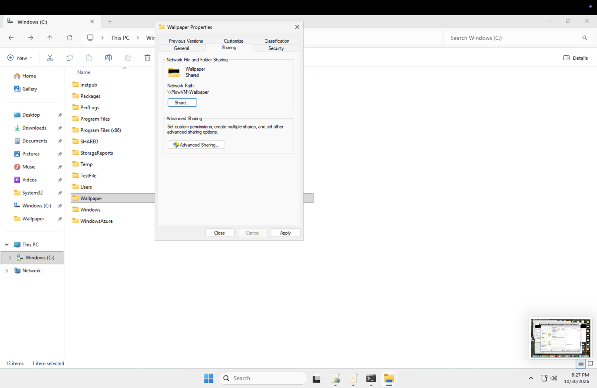
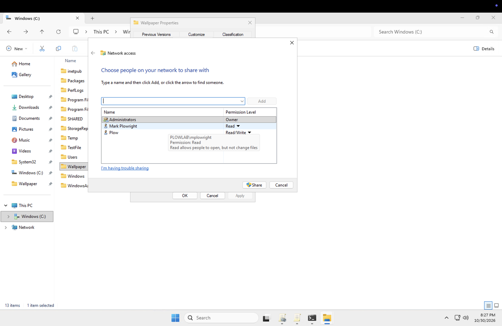
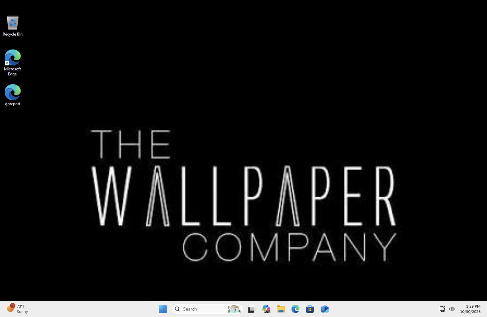
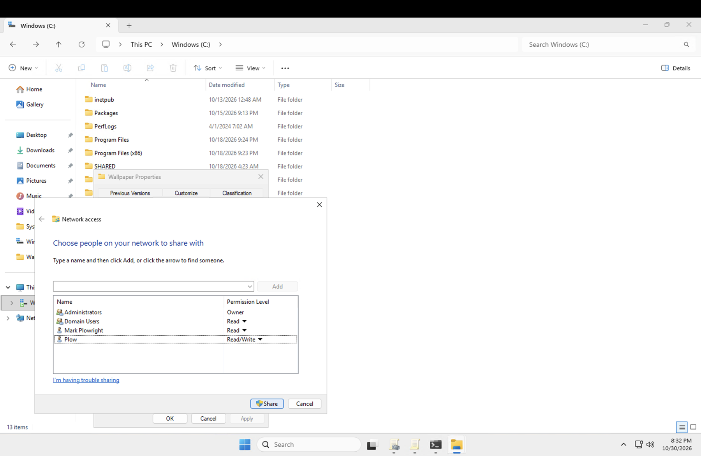

# 08. Fixing the wallpaper GPO (black desktop on the client)

**Goal:** Make the Desktop Wallpaper GPO from [runbook 04](04-group-policy-objects.md) actually show an image for `mplowright` on the Windows 11 client.

## Symptom

The GPO was linked to `USA > Users`, Link Enabled and Enforced both **Yes**, with Authenticated Users in the security filter. The policy was enabled, but after signing in to the client the desktop background was solid black.



## Root cause

The **Wallpaper Name** in the policy was a local path:

```
C:\desktop\wallpaper\companyimage.jpg
```

A `C:\` path is resolved by the computer the user signs in to. The image only existed on the server (`PLOWVM`), so the client looked on its own disk, found nothing, and showed black. The policy's own help text says as much: if the file is not available at logon, no wallpaper is displayed.

The scope and link were fine. The problem was the path, not who the GPO applied to.



## Fix

1. **Put the image in its own folder and share it.** The folder `C:\Wallpaper` on `PLOWVM` is shared as `Wallpaper`, network path `\\PlowVM\Wallpaper`. I used a separate folder on purpose: the `SHARED` folder has an FSRM file screen that blocks image files (see [runbook 07](07-fsrm-quotas-and-file-screening.md)).

   

2. **Set share permissions.** The first attempt granted Read to individual users only.

   

3. **Point the policy at the UNC path** instead of the local path: `\\PlowVM\Wallpaper\companyimage.jpg`. I also changed the style from **Center** to **Fill** so the image scales to the screen.

4. **Refresh on the client.** `gpupdate /force`, then sign out and back in. User policy applies at logon.

## Verify

After signing out and back in as `mplowright`, the desktop shows the company wallpaper.



## Hardening pass

Granting Read to individual accounts works for one test user but does not scale: every new user would need to be added to the share by hand. I changed the share to give **Domain Users** Read, and cleaned up the individual entries. Read-only matters here because anyone with write access could replace the image for every user.



After the change I signed out and back in as `mplowright` again and the wallpaper still loaded.

## Other ways to do it

- **SYSVOL:** put the image in the domain's SYSVOL folder and point the GPO at that UNC path. Domain users can already read SYSVOL, so there are no share permissions to manage. Handy for a small lab.
- **Local copy:** a Group Policy Preferences Files item can copy the image to each client, and the policy can point at the local copy. That keeps the wallpaper working if the server is unreachable.

## What I learned

- A policy that names a file has to name a path the **client** can reach. Use a UNC path for anything that lives on a server.
- A policy can apply correctly and still show nothing. Check scope and link first, then the values inside the setting.
- The user needs permission to read the file, not just the GPO. Share permissions and NTFS permissions both apply, and the stricter one wins.
- Share to a group (Domain Users), not to individual accounts.
- Wallpaper is a user policy, so the change shows up at the next sign-in, not the next `gpupdate` alone.

## Still to do

- Test with a second domain user to confirm the group permission works for someone other than `mplowright`.
- Confirm on the folder's **Security** tab that Domain Users has Read & execute.
- Run `gpresult /h` on the client and add the applied-GPO view as evidence.
